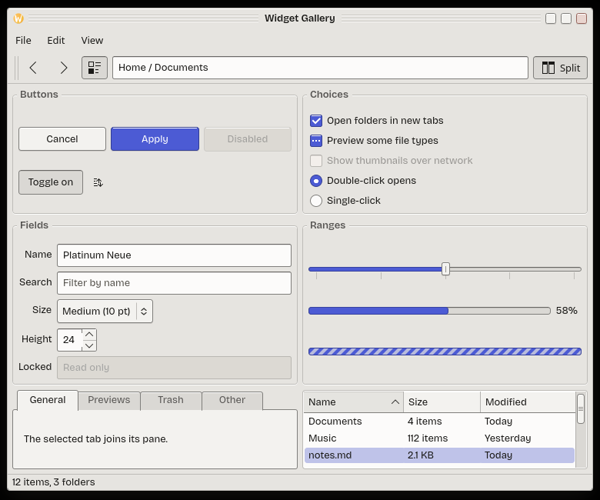
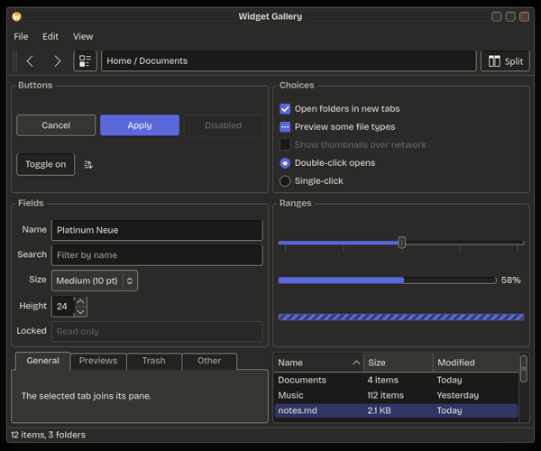

# Platinum Neue

A modern progression of the Mac OS 8/9 Platinum look for KDE Plasma 6, in light and dark.
It aims for good UI first and homage second: neutral warm greys, quiet depth (1px edges, a lit
top line on raised controls, inset fields), and the accent colour used only for selection, focus
and default actions.

 

## What's included

| Part | Where | Notes |
|---|---|---|
| Application style (Qt 6) | `src/kstyle` | Fork of Breeze 6.8.2 |
| Window decoration (KWin) | `src/kdecoration` | Fork of Breeze 6.8.2; pinstriped titlebar |
| Colour schemes | `color-schemes/` | Light and dark |
| Plasma desktop theme | `plasma/desktoptheme/` | Panel, popups, tooltips, controls |
| Global theme | `plasma/look-and-feel/` | Bundles the above, bottom panel layout |
| GTK 3/4 theme | `gtk/` | Builds on Breeze GTK; follows the active colour scheme |
| VS Code theme | `vscode/` | Light and dark colour themes |

Everything visual is generated from one set of design tokens, `tokens/tokens.json`, by the
scripts in `tools/` (`gen.py`, `gen_plasma.py`, `gen_gtk.py`, `gen_vscode.py`).

## Requirements

Plasma 6.8 / KF6 / Qt 6, plus `breeze-gtk` for the GTK theme. The UI font is
[Bricolage Grotesque](https://fonts.google.com/specimen/Bricolage+Grotesque) (not bundled);
the panel clock uses [EB Garamond](https://fonts.google.com/specimen/EB+Garamond), which the
Arch package downloads (SIL Open Font License).

## Install (Arch Linux)

```sh
cd pkg && makepkg -si
```

Then choose **Platinum Neue Light** or **Dark** in System Settings → Colors & Themes → Global Theme,
and **Platinum Neue** under Application Style → Configure GNOME/GTK Application Style.
After updating the Plasma theme, clear its cache:

```sh
rm -rf ~/.cache/plasma-svgelements* ~/.cache/plasma_theme_*.kcache
```

For VS Code: `python3 tools/gen_vscode.py && code --install-extension vscode/platinum-neue-0.1.0.vsix`.

## Building by hand

```sh
cmake -S src -B build -G Ninja -DCMAKE_INSTALL_PREFIX=/usr -DBUILD_TESTING=OFF
cmake --build build
```

`tools/style-test.sh`, `tools/plasma-test.sh` and `tools/gtk-test.sh` take screenshots in a
headless nested KWin session without installing anything.

## Credits and licence

The application style and window decoration are derived from [Breeze](https://invent.kde.org/plasma/breeze)
by the KDE community; upstream copyright notices and licences are kept in the source files and
`src/LICENSES/`. The project as a whole is licensed under the GNU GPL, version 2 or later (see `LICENSE`).

Mac OS and Platinum are trademarks of Apple Inc. This project is an independent tribute and is
not affiliated with or endorsed by Apple.
